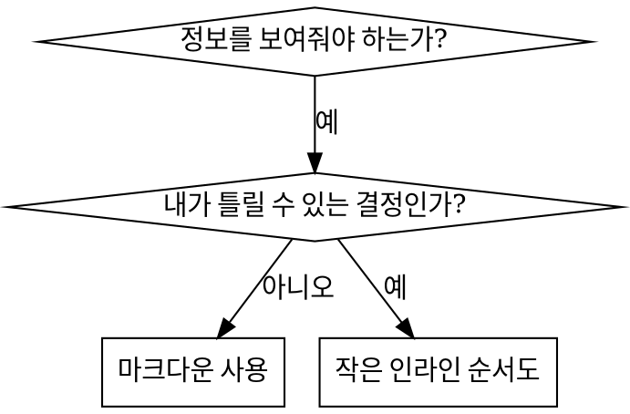

# 스킬 작성 패턴 — 구조·순서도·예시·파일 구성·안티 패턴

SKILL.md의 작성 규칙을 보완하는 참조임.

## SKILL.md 본문 골격

```markdown
---
name: skill-name-with-hyphens
description: Use when [specific triggering conditions and symptoms]
---

# 스킬 이름

## 개요

이것은 무엇인가? 1-2문장으로 핵심 원칙.

## 사용 시점

[결정이 명확하지 않은 경우 간단한 인라인 순서도]

증상과 사용 사례 목록
사용하지 않는 경우

## 핵심 패턴 (기법/패턴의 경우)

이전/이후 코드 비교

## 빠른 참조

일반 작업 스캔을 위한 표 또는 불릿

## 구현

간단한 패턴은 인라인 코드
대용량 참조나 재사용 도구는 파일 링크

## 흔한 실수

무엇이 잘못되는지 + 해결책

## 실제 영향 (선택사항)

구체적인 결과
```

## 순서도 사용



**순서도 사용 경우:**

- 명확하지 않은 결정 지점
- 너무 일찍 멈출 수 있는 프로세스 루프
- "A vs B 중 언제 사용" 결정

**순서도 사용 금지:**

- 참조 자료 → 표, 목록
- 코드 예시 → 마크다운 블록
- 선형 지시사항 → 번호 목록
- 의미 없는 레이블 (step1, helper2)

## 코드 예시

**많은 평범한 예시보다 하나의 훌륭한 예시가 나음**

가장 관련성 높은 언어 선택:

- 테스트 기법 → TypeScript/JavaScript
- 시스템 디버깅 → Shell/Python
- 데이터 처리 → Python

**좋은 예시:**

- 완전하고 실행 가능
- WHY를 설명하는 주석 포함
- 실제 시나리오에서 가져옴
- 패턴을 명확하게 보여줌
- 적용 가능한 형태 (일반적인 템플릿 아님)

**금지:**

- 5개 이상의 언어로 구현
- 빈칸 채우기 템플릿 생성
- 가상의 예시 작성

하나의 훌륭한 예시면 충분.

## 파일 구성

### 독립형 스킬

```
defense-in-depth/
  SKILL.md    # 모든 내용 인라인
```

사용 시: 모든 내용이 맞고, 대용량 참조가 필요 없을 때

### 재사용 도구가 있는 스킬

```
condition-based-waiting/
  SKILL.md    # 개요 + 패턴
  example.ts  # 적용 가능한 작동 헬퍼
```

사용 시: 도구가 서술이 아닌 재사용 가능한 코드일 때

### 대용량 참조가 있는 스킬

```
pptx/
  SKILL.md       # 개요 + 워크플로우
  pptxgenjs.md   # 600줄 API 참조
  ooxml.md       # 500줄 XML 구조
  scripts/       # 실행 가능한 도구
```

사용 시: 참조 자료가 인라인에 넣기엔 너무 클 때

## 안티 패턴

### ❌ 서술적 예시

"2025-10-03 세션에서 빈 projectDir이 원인이었음..."
**이유:** 너무 구체적, 재사용 불가

### ❌ 다중 언어 희석

example-js.js, example-py.py, example-go.go
**이유:** 품질 저하, 유지보수 부담

### ❌ 순서도 내 코드

```dot
step1 [label="import fs"];
step2 [label="read file"];
```

**이유:** 복사 붙여넣기 불가, 읽기 어려움

### ❌ 일반적인 레이블

helper1, helper2, step3, pattern4
**이유:** 레이블에는 의미론적 의미가 있어야 함
